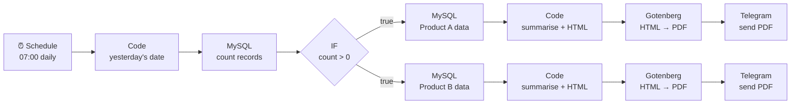
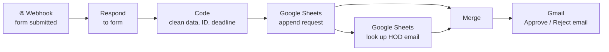
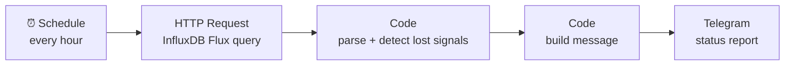

# n8n Automation Workflows

Production n8n workflows I built for QC reporting, HR approvals and facility monitoring. Each one replaces a manual daily task with an automated process.


> All company names, credentials, IDs, hostnames and tokens have been removed. Values to fill in are marked `YOUR_...`.

## Workflows

| | Workflow | Category | Trigger | Highlights |
|---|---|---|---|---|
| ⭐ | [Daily QC Report (PDF to Telegram)](workflows/reporting) | Reporting | Daily at 07:00 | MySQL, conditional logic, HTML→PDF with Gotenberg, Telegram |
| ⭐ | [Early-Leave Approval Request](workflows/hr-automation) | HR Automation | Webhook (form) | Google Sheets, approver lookup, HTML email with Approve/Reject buttons |
| ⭐ | [Temperature Monitoring](workflows/monitoring) | Monitoring | Every hour | InfluxDB sensor data, stale-signal detection, formatted Telegram report |

---

## 📊 Daily QC Report (PDF to Telegram)

QC staff record cut-check inspections during the night shift. Every morning this workflow summarises the previous day's results into two PDF reports, one per product line, and posts them to a Telegram group.



[Details →](workflows/reporting)

## 👥 Early-Leave Approval Request

Employees submit an early-leave request through a web form. The workflow saves it, finds the employee's head of department, and emails them the request with **Approve** and **Reject** buttons.



[Details →](workflows/hr-automation)

## 🌡️ Temperature Monitoring

Every hour, the workflow reads the latest readings from about 30 sensors (chillers, cold rooms, blast freezers, loading bays and production areas) and posts a formatted status report to Telegram.



[Details →](workflows/monitoring)

---

## How to Import

1. In n8n, open **Workflows → Import from File** and choose a `.json` file from `workflows/`.
2. Connect your own credentials (MySQL, Google Sheets, Gmail, Telegram) on the nodes that need them.
3. Replace every `YOUR_...` placeholder with your own values.
4. Test it with **Execute workflow**, then activate it.

## Repository Structure

```
workflows/
├── reporting/       # Daily QC Report (PDF to Telegram)
├── hr-automation/   # Early-Leave Approval Request
└── monitoring/      # Temperature Monitoring
```
