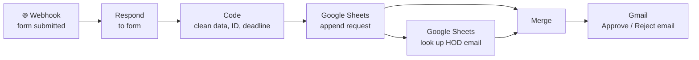

# 👥 Early-Leave Approval Request

**File:** [`early-leave-approval.json`](early-leave-approval.json)

## Problem

During the fasting month, employees can apply to work adjusted hours and leave early. Requests used to be passed around by hand, which made approvals slow and hard to track.

## Solution

Employees submit the request through a web form. The workflow records it in Google Sheets, finds the employee's head of department (HOD), and emails the HOD the request with one-click **Approve** and **Reject** buttons.

## How It Works

1. **Webhook:** receives the form submission (POST) and responds right away, so the employee isn't kept waiting.
2. **Code:** cleans every field, accepts working hours sent either as a list or as text, gives each request a unique ID, and sets a response deadline two days ahead.
3. **Google Sheets (append):** saves the request: employee, position, superior, contact number, working hours, replacement hours and reason.
4. **Google Sheets (lookup):** finds the HOD's email address in a `superior_key` sheet.
5. **Merge:** combines the request with the HOD's details.
6. **Gmail:** sends the HOD an HTML email with the request details, the deadline, and **Approve** / **Reject** buttons.

> The Approve and Reject buttons call a second webhook (`/webhook/early-leave-decision`), which records the decision in the sheet. That workflow is not included in this repository.

## Requirements

- A Google Sheet with:
  - a request sheet with the columns `Id`, `Employee Name`, `Superior`, `Position`, `Contact No`, `Working Hours`, `Replacement`, `Reason`, `Approval`
  - a `superior_key` sheet with the columns `superior_key` and `superior_email`
- Gmail and Google Sheets credentials in n8n

## Configuration

| Placeholder | Replace with |
|---|---|
| `YOUR_GOOGLE_SHEET_ID` | The ID of your Google Sheet |
| `YOUR_N8N_DOMAIN` | Your n8n domain, used in the Approve/Reject links |
