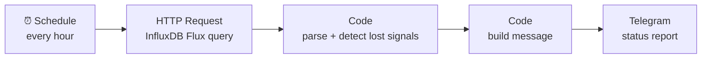

# 🌡️ Temperature Monitoring

**File:** [`temperature-monitoring.json`](temperature-monitoring.json)

## Problem

Cold-chain areas (chillers, cold rooms, blast freezers, loading bays and production areas) have to stay within safe temperatures. Checking each sensor dashboard by hand every hour wasn't practical.

## Solution

Every hour the workflow reads the latest value from about 30 IoT sensors in InfluxDB and posts one clear status report to a Telegram group.



## How It Works

1. **Schedule Trigger:** runs every hour.
2. **HTTP Request:** sends a Flux query to the InfluxDB API for the most recent reading (last 30 minutes) of each sensor: temperatures, door-opening distances and defrost status.
3. **Code (parse):**
   - parses the CSV response and keeps the newest value per sensor
   - marks a sensor **Signal Lost** if its data is more than 30 minutes older than the newest reading, so a dead sensor isn't mistaken for a normal one
   - shows door status as OPEN or CLOSED, and defrost status as ON or OFF
4. **Code (format):** builds an HTML Telegram message grouped by area, using 🟢 / 🔴 / ⚠️ status icons.
5. **Telegram:** posts the report, retrying up to 5 times.

### Example message

```
🌡 Chiller Blast
• CB 1: -2.10 °C
• CB 2: -1.85 °C

🌡 Chiller Room
• Door: 3.40 °C
• Door Distance: 0 (CLOSED)
• Activity: Defrosting OFF 🔴

🌡 Coldrooms
• 1 Door: -18.20 °C
• 2 Door: Signal Lost ⚠️
...
```

*(Values are illustrative.)*

## Requirements

- InfluxDB 2.x with sensor data in the `telemetry` measurement
- A Telegram bot added to the target group

## Configuration

| Placeholder | Replace with |
|---|---|
| `YOUR_INFLUXDB_TOKEN` | An InfluxDB API token with read access. Better still, store it as an n8n credential instead of in the header |
| `YOUR_ORG` | Your InfluxDB organisation |
| `http://influxdb:8086` | Your InfluxDB URL |
| `sensors` | Your InfluxDB bucket name |
| `YOUR_TELEGRAM_CHAT_ID` | Your Telegram group chat ID |
| Sensor topics in the Flux query | Your own sensor topic names |
