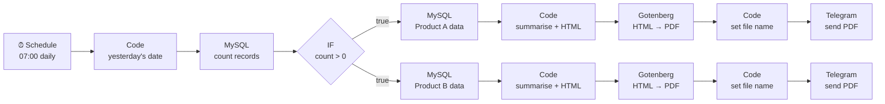
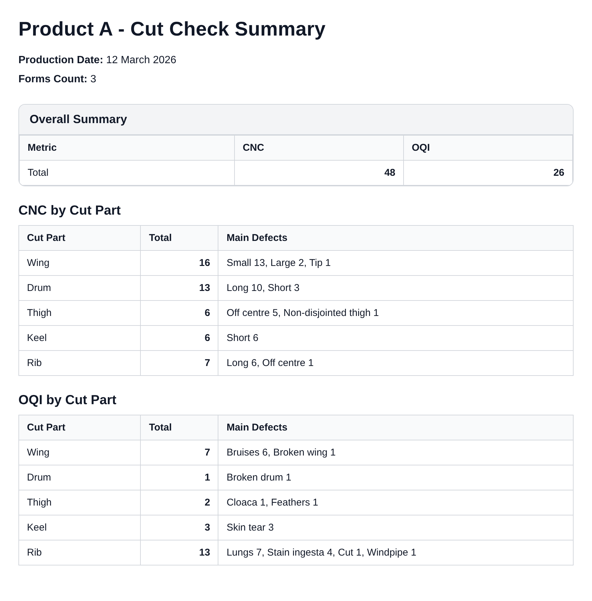

# 📊 Daily QC Report (PDF to Telegram)

**File:** [`daily-qc-report-pdf.json`](daily-qc-report-pdf.json)

## Problem

QC staff record cut-check inspections on a form during the night shift, and supervisors needed a summary every morning. Building it by hand meant pulling the data, counting the defects and formatting a report.

## Solution

Every day at 07:00 the workflow builds two PDF summaries of the previous day's inspections and sends them to a Telegram group.

## How It Works

1. **Schedule Trigger:** runs at 07:00 every day.
2. **Code:** works out the production date to report on (the day before).
3. **MySQL:** counts that day's QC records. **IF** the count is 0, the workflow stops, so no empty report is sent.
4. **MySQL** (one per product line): fetches the inspection rows.
5. **Code:** parses the defect codes recorded on each form (e.g. `3DP, 2SH`), totals them per cut part (wing, drum, thigh, keel, rib) and per defect type, and builds a styled HTML report.
6. **HTTP Request → Gotenberg:** converts the HTML into a PDF.
7. **Code:** names the file with the date, e.g. `ProductA-QC-Report-12-March-2026.pdf`.
8. **Telegram:** sends the PDF to the group, retrying if it fails.

## Sample Output

Generated by this workflow's own report code using **fake data** ([download PDF](../../docs/sample-qc-report.pdf)):

## Requirements

- MySQL with tables `qc_form.cutcheck_product_a` and `qc_form.cutcheck_product_b`
- [Gotenberg](https://gotenberg.dev/) reachable from n8n at `http://gotenberg:3000`
- A Telegram bot added to the target group

## Configuration

| Placeholder / setting | Replace with |
|---|---|
| `YOUR_TELEGRAM_CHAT_ID` | Your Telegram group chat ID |
| MySQL credential | Your database connection |
| Telegram credential | Your bot token |
| Workflow timezone | Your local timezone (currently `Asia/Singapore`) |
